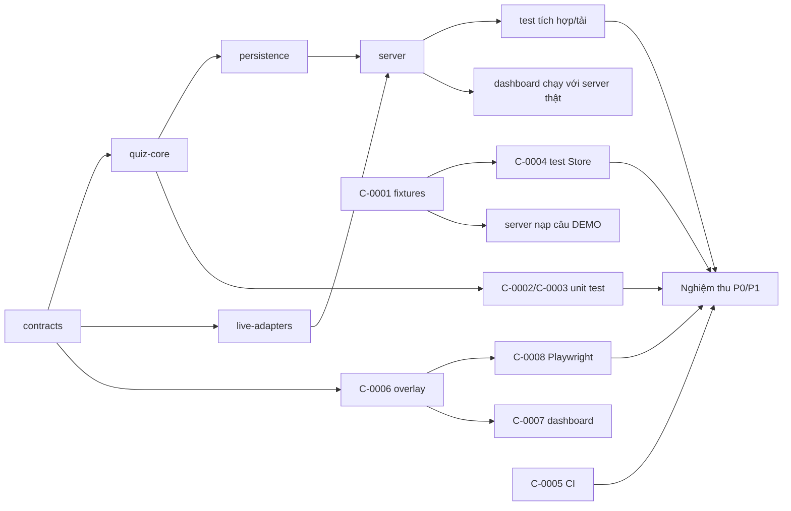

# Backlog triển khai + đồ thị phụ thuộc + sổ rủi ro

Trạng thái: ✅ xong · 🔄 đang làm (làn) · ⬜ chưa làm. Mã C-xxxx = thư giao việc trong `mailbox/`.

## Phase 0 — nền móng
| Mã | Việc | Làn | TT |
|---|---|---|---|
| P0-1 | Kiểm kê đầu vào, phân loại nhạy cảm (`docs/HANDOFF.md`) | coordinator | ✅ |
| P0-2 | Monorepo, tsconfig strict, vitest projects | coordinator | ✅ |
| P0-3 | `contracts` (Zod) | coordinator | ✅ |
| P0-4 | Schema SQLite 19 bảng + migration | coordinator | ✅ |
| P0-5 | ADR, kiến trúc, hợp đồng API | coordinator | ✅ |
| P0-6 | privacy-check + CI | codex1 C-0005 | 🔄 |
| P0-7 | DATA_PRIVACY, TEST_PLAN | codex1 DP1/DP2 | ⬜ |
| P0-8 | GAME_RULES, THEME_PACK_SPEC | codex2 DP3/DP4 | ⬜ |

## Phase 1 — engine offline
| Mã | Việc | Làn | TT |
|---|---|---|---|
| P1-1 | quiz-core: parse, cửa sổ, chấm điểm, xếp hạng, podium, selection, reducer | coordinator | ✅ |
| P1-2 | persistence `Store` | coordinator | ✅ |
| P1-3 | live-adapters: Mock, Blocked, Scheduler, Simulator | coordinator | ✅ |
| P1-4 | Fixtures DEMO | codex1 C-0001 | 🔄 |
| P1-5 | Unit test answers/scoring/selection | codex1 C-0002 | 🔄 |
| P1-6 | Unit test reducer | codex1 C-0003 | 🔄 |
| P1-7 | Unit test Store | codex1 C-0004 | 🔄 |
| P1-8 | Server: SessionRuntime, routes, WS, recovery | coordinator | ✅ `04aa4a4` |
| P1-9 | Test tích hợp + tải | coordinator | ✅ |
| P1-10 | Overlay 8 cảnh | codex2 C-0006 | 🔄 |
| P1-11 | Dashboard Live Control | codex2 C-0007 | 🔄 |
| P1-12 | Playwright smoke + ảnh | codex2 C-0008 | 🔄 |
| P1-13 | `scripts/simulate-round.ts` | coordinator | ✅ |
| P1-14 | Gộp nhánh, chạy toàn bộ, báo cáo nghiệm thu Phase 0/1 | coordinator | ⬜ |

## Đồ thị phụ thuộc

## Phase sau (KHÔNG làm ở đợt này)
- Phase 2: theme-core (manifest, đổi pack không đổi code), Question Bank, import/export, approval, SMART_RANDOM 7/5/3, tie-break công bố trước vòng.
- Phase 3: AI Question Studio, bằng chứng, chống SSRF, duyệt tay.
- Phase 4: spike khả thi TikTok — **nên chạy song song sớm** để biết giới hạn truy cập.
- Phase 5: overlay semi-3D Storm Arena, HUD simulator, cúp/sân gốc, chibi (cần xác nhận quyền asset + ánh xạ `IMG_2125…` ↔ file "Ảnh ChatGPT…").
- Phase 6: auto mode nhiều vòng + preflight, backup định kỳ, purge/export, đóng gói Windows, tổng duyệt.

## Sổ rủi ro
| # | Rủi ro | Mức | Giảm thiểu / trạng thái |
|---|---|---|---|
| R1 | Không có kết nối TikTok LIVE được phép, ổn định | Cao | Adapter BLOCKED; chỉ ship mock-ready; spike Phase 4 sớm |
| R2 | Comment trễ / bị đệm / mất trên kết nối thật | Cao | Cửa sổ theo giờ server, cách ly `sourceTimestamp` cũ, mất kết nối → treo câu; báo giới hạn cho operator |
| R3 | Vùng an toàn khác theo máy/chế độ LIVE | TB | Preset chỉnh được, lớp hướng dẫn, kiểm trên điện thoại thật Phase 5 |
| R4 | Bản quyền font GFF, cúp, chibi, logo đội | TB | Phase 1 chỉ token màu; cần người dùng xác nhận quyền trước Phase 5 |
| R5 | Megasheet có ô lỗi/placeholder, dữ liệu nhạy cảm | TB | Không nhập; chỉ dữ kiện công khai được duyệt từng trường; privacy-check |
| R6 | AI bịa dữ kiện giải đấu | Cao | Phase 3: bắt buộc bằng chứng + duyệt tay, không auto-approve |
| R7 | Repo GitHub đang PUBLIC | TB | Không push xlsx/ảnh/dữ liệu người thật; cân nhắc chuyển private |
| R8 | Diễn giải luật chuỗi (thưởng lại sau reset) | Thấp | Ghi D-12, chờ người dùng xác nhận |
